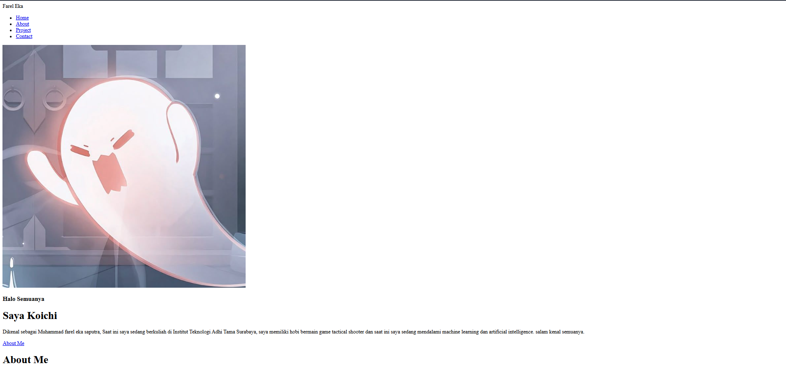
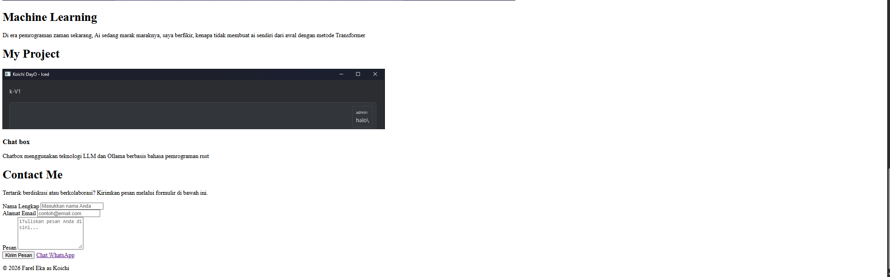
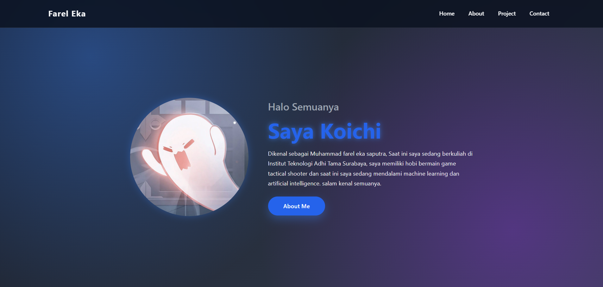
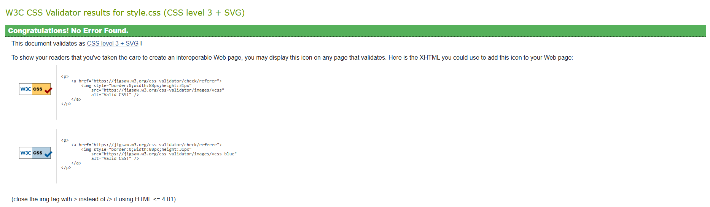

Nama : Muhammad Farel Eka Saputra
NPM : 06.2025.1.07854
Matakuliah : Pemrograman Web

1. perbedaan web sebelum dan sesudah menggunakan style.css

sebelujm menggunakan css

setelah menggunakan css

2. ai yang di gunakan saat membuat website ini adalah antigravity dengan model gemini 3.8 dengan prompt sebagai berikut

    "buatkan saya sebuah website bertema biru tua dengan ketentuan sebagai berikut 
    1. Struktur HTML semantik dengan bagian: Header/Navbar, Home (profil singkat), About Me, Projects, dan Contact.
    2. Styling menggunakan Vanilla CSS murni dengan tema Dark Mode & Glassmorphism (efek kaca blur).
    3. berisi tentang rust language, backend dev, devops engginer, dan machine learning, lalu siapkan untuk bagian isinya untuk deskripsi di tag paragaph untuk saya isi sendiri.
    4. Palet warna harmonis maksimal 5 warna utama dengan kontras tinggi yang ramah aksesibilitas.
    5. Layout responsif untuk mobile dan desktop (menggunakan Flexbox dan Grid), lengkap dengan tombol navigasi
    menu dan ikon Font Awesome.
    6. buatkan juga bagian form di beri gaya label, kolom, dan tombol. untuk tombol gunakan warna biru muda dan untuk   chat whatsapp di sebelahnya gunakan tombol yang sama namun agak terang dengan warna background contactme di bagian bawah sendiri.

3. tangkapan layar hasil W3css validator

4. Sumber Aset & Lisensi
- Font & Ikon: Font Awesome 6 (Free CDN)
- Gambar / Foto: 
  - profil dari screenshoot game
  - foto program rust dari screenshot
  - backend, machine learning, devops promt menggunakan AI model Opus 3.6

5. css
   1. **CSS Reset & Box Model (`*`, `box-sizing: border-box`)**
      - Menggunakan `* { box-sizing: border-box; margin: 0; padding: 0; }` untuk me-reset margin dan padding default bawaan browser, serta memastikan ukuran elemen dihitung akurat bersama padding dan border.
      - Menambahkan `scroll-behavior: smooth` pada `html` agar perpindahan navigasi antar-section terasa halus.
   2. **CSS Custom Properties / Variables (`:root`)**
      - Mengatur 5 palet warna utama konsisten yang lolos uji kontras aksesibilitas WebAIM AA:
        - `--bg-main` (`#0b1220`) & `--bg-surface` (`#111b2e`): Warna gelap dasar bertema malam.
        - `--primary` (`#2563eb`): Aksen biru elektrik untuk tombol dan sorotan link.
        - `--text-main` (`#f3f4f6`) & `--text-secondary` (`#9ca3af`): Warna teks dengan rasio kontras tinggi (>15:1).
      - Menyimpan variabel jarak (`--space-*`), radius (`--radius-*`), serta efek glassmorphism (`--glass-bg`, `--glass-blur`).
   3. **Glassmorphism & Background Aurora**
      - Menggunakan kombinasi `radial-gradient` dan `linear-gradient` bertingkat pada `body` untuk menghasilkan efek cahaya aurora di latar belakang gelap.
      - Menggunakan `backdrop-filter: blur(14px)` dan `rgba()` transparan pada header, kartu proyek, dan formulir untuk menciptakan efek kaca es modern (glassmorphism).
   4. **Penggunaan Minimal 6 Jenis Selektor Khusus**
      - *Class Selector* (`.project-card`): Menata kartu portofolio proyek.
      - *Child / Descendant Selector* (`.navbar ul > li > a`): Menargetkan tautan navigasi di dalam list menu.
      - *Attribute Selector* (`input[type="text"]`, `input[type="email"]`): Mengatur input form kontak secara spesifik.
      - *Pseudo-class Selector* (`:hover`, `:focus-visible`): Efek interaktif saat kursor diarahkan atau tombol difokuskan dengan keyboard (aksesibilitas).
      - *Pseudo-element Selector* (`::placeholder`, `::selection`): Menata teks placeholder dan warna seleksi teks saat diblok.
      - *Structural Selector* (`:nth-child`, `:not(:disabled)`): Mengatur variasi baris ganjil/genap dan status aktif tombol.
   5. **Tata Letak Layout (Flexbox & CSS Grid)**
      - **Flexbox**: Digunakan pada Header (`navbar`), Hero section (`.home`), dan perataan item tombol formulir.
      - **CSS Grid**: Digunakan pada galeri kartu proyek (`.project-container`) agar tersusun otomatis dan rapi.
   6. **Responsivitas & Media Queries (`@media`)**
      - Mengatur breakpoint layar mobile (`max-width: 768px` dan `max-width: 480px`) agar menu navigasi beralih ke mobile drawer/burger menu, serta mengubah susunan grid menjadi 1 kolom yang nyaman dibaca di smartphone.
